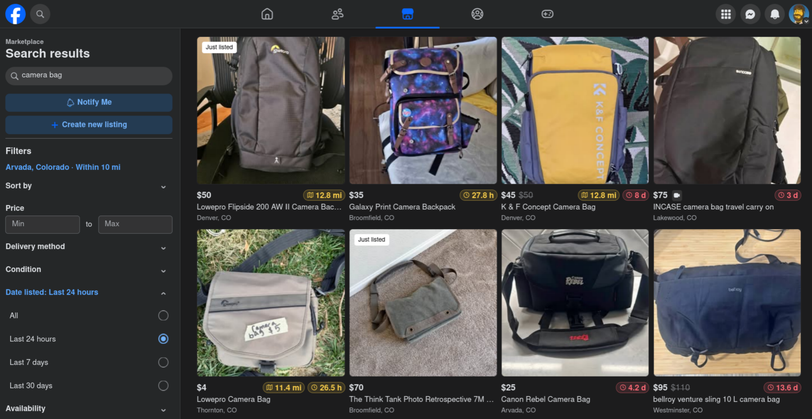

# Marketplace Local Only

A Violentmonkey userscript for TheFaceBook Marketplace. The location, date listed, and shipping filters in Marketplace are more of a suggestion than a rule. This userscript flags the stuff that's too far away or too old, and can hide it entirely. Not so much a complete overhaul as "just make it work the way it says it does."

I've allowed TheFaceBook a little grace here by showing visible distance warnings. I think a little fuzzy matching here is OK, but by default it hides posts more than 5x the search radius, because if my filter is 10 miles, I'm probably not stretching my range to 868.1 miles.



It also hides eBay, Poshmark, and listings labeled for shipping by default. This is not an "ad-blocker", but one *_could hypothetically_* pair it with something like [uBlock Origin.](https://addons.mozilla.org/en-US/firefox/addon/ublock-origin/) which is also not an "ad blocker", but might make your browsing experience safer, and faster.

## Install in Firefox

1. Install Violentmonkey. [Official Firefox add-on](https://addons.mozilla.org/firefox/addon/violentmonkey/)
2. Open [Install Marketplace Local Only](https://raw.githubusercontent.com/robertely/marketplace-local-only/main/marketplace-local-only.user.js) and confirm the install in Violentmonkey.
3. Open Marketplace and select **Marketplace Local Only settings** from the Violentmonkey menu. [Facebook Marketplace](https://www.facebook.com/marketplace/)

## Settings

Defaults follow your Marketplace radius and selected date window:

- **Distance tags:** on; yellow over 1×, red from 2×. Hide beyond 5× the radius.
- **Date tags:** on; yellow over 1×, red from 2×. Hide older than 3× the date window.
- **Show distance within my radius:** off.
- **Hide listings labeled for shipping:** on.
- **Hide partner listings:** on. Includes eBay, Poshmark, and other marked partners.

Edit colors and cutoffs. Each tag type and hide rule can be switched off separately.

The screenshot includes listings older than the default hide cutoff.

## Estimates and privacy

Designed for desktop Marketplace in English.

Distances are straight-line estimates from your search center to city coordinates. The [Census lookup](https://www.census.gov/geographies/reference-files/time-series/geo/gazetteer-files.2026.html) covers the 50 states, DC, and Puerto Rico. Unknown cities keep their location text and get no distance tag.

Age rules use creation time and your 24-hour, 7-day, or 30-day filter. Renewal may differ; unknown ages are skipped.

Shipping and partner filtering depend on TheFacebook's labels and data. Filtering runs locally; Violentmonkey stores settings in your browser.

## Developer tests (Linux)

Requires Linux, Node.js 22+, Bubblewrap, Firefox at `/usr/lib/firefox/firefox`, and signed Violentmonkey.

```sh
node test-firefox.mjs        # Offline tests in a disposable profile
node test-firefox.mjs --live # Persistent test profile on Wayland
```

Optional signed `.xpi` path: first argument for offline tests; after `--live` for live setup.

Live mode uses a separate profile and preserves login. Install script updates manually.

## License

[MIT](LICENSE).
